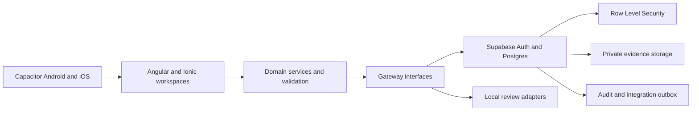

# Senatla Ops

[](https://github.com/Sankofa-Digital-Studio/senatla-ops-internal-automation-solution/actions/workflows/ci.yml)
[](https://github.com/Sankofa-Digital-Studio/senatla-ops-internal-automation-solution/actions/workflows/native-platforms.yml)
[](https://angular.dev/)
[](https://ionicframework.com/)
[](https://supabase.com/)

Senatla Ops is Senatla Trading's internal operations control platform. It connects field attendance, safety, workforce administration, payroll controls, assets, maintenance, approvals, audit evidence, and executive oversight in one accountable workflow.

> **Internal operations system:** access is role-controlled. Do not place credentials, employee information, private evidence, or service-role keys in issues, pull requests, screenshots, or generated artifacts.

The public Senatla Trading website is maintained outside this repository and remains out of scope.

## Product outcome

Senatla Ops gives each operational record an explainable history: who acted, where the work happened, when it changed, which approval applied, and what source evidence supports it. This operational heartbeat helps field, office, and executive users work from the same facts without turning the system into a generic ERP.

## Product boundary

- Senatla Trading is the single legal owner in the current release.
- Engineering is a functional label, not a separate tenant.
- Supabase is the production persistence and authorization boundary.
- Serial number, VIN, and registration plate are case-insensitive alternate asset identifiers; at least one is required.
- AI recommendations, full spares ERP, telematics, and multi-company user interfaces are deferred.

## Application roles

| Role | Primary responsibility | Typical evidence |
|---|---|---|
| Site Manager | Capture attendance, safety, daily site records, and signed synchronization | Attendance rows, safety topics, comments, evidence, and sync status |
| Office Administrator | Administer workforce, sites, issues, payroll, assets, vendors, and requests | Reconciliations, assignments, approvals, exports, and audit history |
| Director and Reviewer | Review source-backed metrics and complete assigned maker-checker decisions | Drill-down records, approval decisions, release and exception evidence |

## Core capabilities

- Attributable attendance and site-day synchronization with offline recovery.
- Workforce, issue, payroll, vendor, and approval controls.
- Asset identity, custody, compliance, fuel, cost, and maintenance records.
- Private evidence capture with human-reviewed OCR provenance.
- Executive readiness and cost views linked to persisted source records.
- Immutable audit events and role-negative database contracts.
- Responsive web delivery plus Android and iOS application foundations.

## Architecture



The application keeps user-interface concerns separate from domain validation and persistence gateways. Database policies enforce authorization; route guards and hidden controls are usability measures, not security boundaries. See [Architecture](docs/architecture.md) and [ADR 0001](docs/adr-0001-supabase-auth-boundary.md).

## Technology

| Layer | Technology |
|---|---|
| Web application | Angular 22, Ionic 8, TypeScript 6, RxJS |
| Native application | Capacitor 8, Android, iOS |
| Data and identity | Supabase Auth, PostgreSQL, Row Level Security, Storage |
| Verification | Jasmine and Karma, Playwright, Cypress, pgTAP |
| Delivery | GitHub Actions and Vercel |

## Prerequisites

- Node.js 24 and npm.
- Docker Desktop with a working Linux container engine for local Supabase validation.
- Chromium dependencies for Playwright and Chrome Headless tests.
- Xcode on macOS for iOS builds and an Android SDK for Android builds.

## Local setup

1. Clone the repository and install the locked dependencies.

   ```bash
   npm ci
   ```

2. Copy `.env.example` to `.env` and provide the environment-specific values. Never commit `.env`.

3. Start the web application.

   ```bash
   npm start
   ```

4. For database work, start the local Supabase stack and run its contracts.

   ```bash
   npm run supabase:start
   npm run supabase:test
   ```

Runtime configuration is generated by `scripts/write-runtime-config.mjs`. Production builds must fail closed when required Supabase configuration is missing.

## Quality gates

```bash
npm run verify
```

`npm run verify` is the deterministic application release gate. It runs lint, application and specification type-checking, a production build, and headless unit tests with per-step evidence.

Additional gates:

```bash
npm run test:responsive
npm run test:e2e:cypress
npm run supabase:test
npm run native:sync:android
npm run native:sync:ios
```

Compilation alone does not prove that browser flows, database policies, native builds, or Supabase contracts pass. Use the [testing strategy](docs/testing.md) and [release checklist](docs/release-checklist.md) for the required evidence.

## Repository map

| Path | Purpose |
|---|---|
| `src/app` | Angular pages, reusable components, domain services, gateways, and tests |
| `supabase/migrations` | Versioned database schema, policies, triggers, and functions |
| `supabase/tests` | pgTAP and SQL contract tests |
| `tests/responsive` | Desktop and mobile responsive evidence |
| `android` and `ios` | Capacitor native projects |
| `docs` | Architecture, runbooks, UAT, release, and client-review sources |
| `scripts` | Runtime configuration, verification, validation, and artifact generation |
| `output` | Generated review artifacts; source files remain authoritative |

## Delivery workflow

- GitHub Issues authorize work and define acceptance criteria.
- Integration pull requests target `dev`; reviewed production promotions target `main`.
- The [Senatla Ops project board](https://github.com/orgs/Sankofa-Digital-Studio/projects/2) records the actual delivery state.
- A merged pull request is not release evidence by itself. Required application, database, responsive, native, deployment, rollback, and UAT checks must be recorded.
- Durable documents must reference a commit and the current deployment record, not an old immutable preview URL.

See [Contributing](CONTRIBUTING.md) and the [GitHub delivery backlog](docs/github-delivery-backlog.md).

## Security and privacy

- Do not report security-sensitive findings in a public issue.
- Keep service-role credentials, access tokens, personal data, OCR text, and private storage paths out of logs and artifacts.
- Test authorization with direct database and API requests, including negative role and site cases.
- Use reviewed forward migrations for production database changes and record rollback steps before deployment.

## Documentation

- [Client ecosystem review](docs/client-senatla-ops-planning-requirements-guidance.md)
- [Client requirements workbook](docs/senatla-ops-client-requirements-feedback-template.md)
- [Engineering handbook](docs/sankofa-senatla-ops-engineering-handbook.md)
- [Environment boundaries](docs/environments.md)
- [Admin and timesheet register scope](docs/admin-timesheet-register.md)
- [Operations runbook](docs/runbook.md)
- [Release checklist](docs/release-checklist.md)
- [Artifact register](docs/artifact-register.md)
- [OCR device UAT](docs/ocr-device-uat.md)

## License and access

No open-source license is granted by this repository. Use and distribution are controlled by Sankofa Digital Studio and Senatla Trading.
