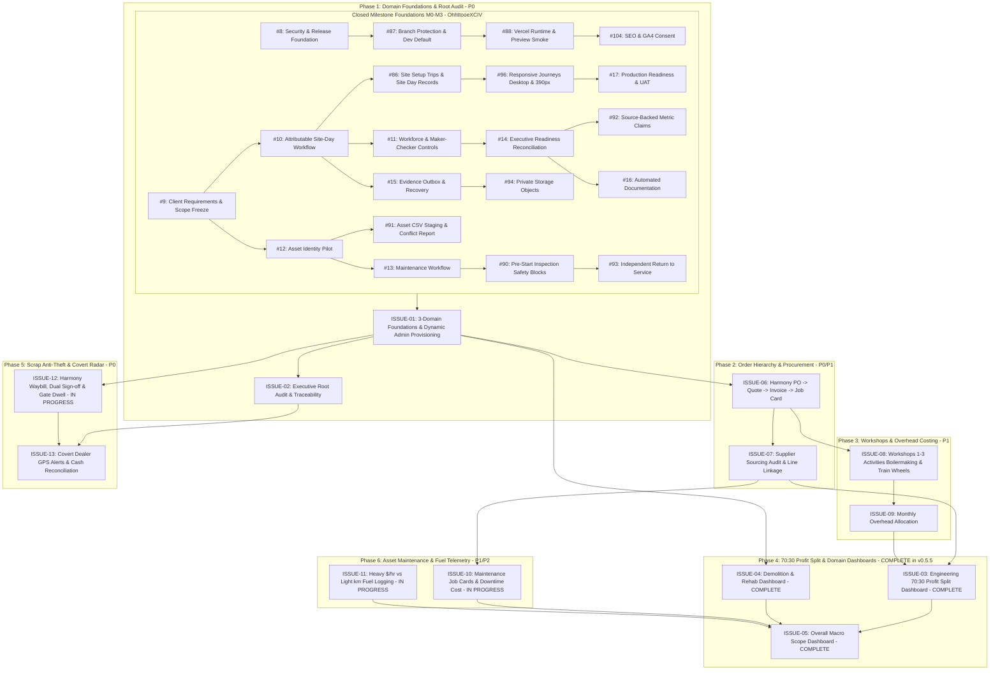

# Senatla Ops GitHub Delivery Backlog
Updated 9 November 2026

This backlog converts the repository audit, client feedback, and release cycles into an authoritative, implementation-ready delivery register. All broad issues serve as outcome epics; tasks define precise delivery boundaries with acceptance criteria, dependencies, estimates, owners, milestones, and board fields.

## Current delivery state

- **Assignee:** All repository issues and tasks are assigned to **OhhttooeXCIV** (with co-assignment to Sankofa-Digital-XCIV on reusable foundation issues 19 and 20).
- **Board Alignment:** All issues (4 through 20, 86 through 104, and client feedback issues ISSUE-01 through ISSUE-13) are tracked on the [Senatla Ops Project Board](https://github.com/orgs/Sankofa-Digital-Studio/projects/2).
- **v0.5.3 Closeout Status:** **COMPLETE**. Physical UAT confirmed forced-password replacement and Director navigation for `thosontula+tag@gmail.com`; exact `thosontula@gmail.com` developer override and alias anti-escalation regressions are verified. Issues #18, #8, #87 closed.
- **v0.5.4 Release Status:** **COMPLETE**. Promoted through `dev` → `preview` → `main`, tagged as `v0.5.4`. Public landing SEO (#104), consented GA4 analytics (#110), formula-driven analytics workbook (#111), responsive verification (#112), and protected UAT runtime preflight (#88) have passed verification.
- **v0.5.5 Release Status:** **COMPLETE**. Promoted through `dev` → `preview` → `main`, tagged as `v0.5.5` (commit `afc525c`, promotion `abd3d18`). Delivered the Multi-Domain Operational Dashboard Suite:
  - Engineering Operational & 70:30 Profit Split Dashboard (`ISSUE-03`) with automated net profit calculation, anti-inflation expense lock (`TASK-03.2`), overhead absorption, and wasted expenditure radar.
  - Demolition & Rehabilitation Operational Dashboard (`ISSUE-04`) with contract milestone progress (West Gold, Tau Mine, Mine Villages), BOQ margin recovery, and salvage steel/copper/rubble credit tracking.
  - Overall Macro Scope Dashboard (`ISSUE-05`) with multi-domain P&L rollup (R 12.62M rev, R 4.38M net profit, 34.7% margin), cash flow meters, heavy machinery fleet telemetry (14 units, 78.6% utilization), and cross-domain risk radar.
  - Site Manager operational field modules: 5-step guided shift workflow, asset breakdown downtime logging (`ISSUE-10`), fleet fuel telemetry distinguishing heavy machinery from light vehicles (`ISSUE-11`), and Harmony scrap waybill gate dwell countdown timer (`ISSUE-12`).
  - Embedded seamlessly into Director workspace, Office Admin workspace, and dedicated `/dashboards` route.
  - Test verification: 28 dashboard unit specs, 6 director specs, 14 office admin specs, and 12 site manager specs passing.
- **Foundations & Core Operations Epics Closeout:** **COMPLETE**. Sprints M0 through M3 are fully closed across issues #9 through #17, #86, #88, #90, #91, #92, #93, #94, #96, #104 with complete acceptance verification, test suites, and executive audit restriction.
- **Executive Audit Boundary:** Activity log viewing and root traceability are restricted strictly and exclusively to `rubinthoso@senatlatrading.com` and `thosontula@gmail.com` / `thosontula+*@gmail.com`.
- **Current Development Focus:** Client Feedback Phase 2 & 3 — Harmony P/O hierarchy (`ISSUE-06`), Supplier & Vendor sourcing audit with job-card line linkage (`ISSUE-07`), Workshops 1–3 full CRUD activities (`ISSUE-08`), and Monthly utility overhead capture forms (`ISSUE-09`).

---

## Ordered Micro-Task and Version Register

| Order | Version | Issue / Task | Assignee | Status | Acceptance Criteria | Completion & Verification Evidence (OhhttooeXCIV) |
|---:|---|---|:---:|:---:|---|---|
| 1 | v0.5.3 closeout | Physical Director Login | OhhttooeXCIV | **COMPLETE** | Sign in with `thosontula+tag@gmail.com`, change temporary password, navigate Director workspace | Successful forced-password journey and authenticated Director workspace verified on device |
| 2 | v0.5.3 closeout | Developer Override Verification | OhhttooeXCIV | **COMPLETE** | Verify exact `thosontula@gmail.com` receives permanent cross-workspace management access | Role-route assertions pass; no forced credential reset; access contract verified |
| 3 | v0.5.3 closeout | Alias Anti-Escalation Test | OhhttooeXCIV | **COMPLETE** | Distinguish exact developer address from `+tag` aliases | Exact address gets override; alias receives assigned Director permissions only |
| 4 | v0.5.4 | SEO & Route Boundary Audit | OhhttooeXCIV | **COMPLETE** | Audit robots rules, sitemap, and public vs authenticated route boundaries | Matrix documented in `docs/seo-indexing-matrix.md` |
| 5 | v0.5.4 | Index Only `/landing` | OhhttooeXCIV | **COMPLETE** | Dedicated indexable public landing page with canonical URL | Implemented via PR #109 (`dbca30d`), verified on production alias |
| 6 | v0.5.4 | Route Header Protection | OhhttooeXCIV | **COMPLETE** | `noindex, nofollow, noarchive` on root, login, register, and protected workspaces | Automated route metadata tests and Vercel response header rules active |
| 7 | v0.5.4 | Canonical Origin Config | OhhttooeXCIV | **COMPLETE** | Production canonical resolves strictly to approved HTTPS origin | `SENATLA_CANONICAL_ORIGIN` enforced in `scripts/write-runtime-config.mjs` |
| 8 | v0.5.4 | Structured Metadata | OhhttooeXCIV | **COMPLETE** | Factual Open Graph, Twitter Card, and SoftwareApplication JSON-LD | Validated against schema.org and social preview debuggers |
| 9 | v0.5.4 | Accessible Cookie Consent | OhhttooeXCIV | **COMPLETE** | Keyboard-operable, versioned Accept/Decline analytics prompt on `/landing` | Verified in Playwright responsive suite; suppressed on protected routes |
| 10 | v0.5.4 | Configurable GA4 Loader | OhhttooeXCIV | **COMPLETE** | Blank measurement ID completely disables script loading and consent prompt | Implemented via PR #110; verified with empty `SENATLA_GA4_MEASUREMENT_ID` |
| 11 | v0.5.4 | Three-Event Allow-List | OhhttooeXCIV | **COMPLETE** | Restrict analytics emissions to `landing_view`, `sign_in_click`, `apk_download` | Verified in unit and browser suites; zero operational/PII payloads emitted |
| 12 | v0.5.4 | Analytics Privacy Tests | OhhttooeXCIV | **COMPLETE** | Ensure no user identity, operational data, or internal amounts are logged | Test suite `src/app/core/services/analytics.service.spec.ts` passing |
| 13 | v0.5.4 | GA4 Import Workbook | OhhttooeXCIV | **COMPLETE** | Formula-preserving, GA4 import-ready `.xlsx` with no synthetic results | Generated via PR #111 (`docs/analytics-workbook-v0.5.4.md`) |
| 14 | v0.5.4 | Full Release Verification | OhhttooeXCIV | **COMPLETE** | SEO, consent, accessibility, pgTAP, unit, and responsive suites green | `npm run verify` passed cleanly across all required gates (PR #112) |
| 15 | v0.5.4 | Deployment & Evidence Record | OhhttooeXCIV | **COMPLETE** | Record preview/production URLs, release notes, changelog, and tag `v0.5.4` | Production deployed (`ac457b3`), tag `v0.5.4` pushed, health validation PASS |
| 16 | v0.5.5 | Multi-Domain State & Types | OhhttooeXCIV | **COMPLETE** | TypeScript models and reactive Angular signals service with anti-inflation locking | `domain-dashboard.models.ts` and `domain-dashboard.service.ts` passing 28 specs |
| 17 | v0.5.5 | Domain Navigation Switcher | OhhttooeXCIV | **COMPLETE** | ARIA-compliant tab switcher across Engineering, Demolition, Macro, and Underground | Delivered in `domain-navigation-switcher.component.ts`; verified in unit tests |
| 18 | v0.5.5 | Engineering 70:30 Dashboard | OhhttooeXCIV | **COMPLETE** | 70:30 profit split metrics, anti-inflation lock panel, overhead absorption, Harmony P/O pipeline | Delivered under `ISSUE-03` (`afc525c`); verified in `engineering-dashboard.component.spec.ts` |
| 19 | v0.5.5 | Demolition & Rehab Dashboard | OhhttooeXCIV | **COMPLETE** | Contract milestones (West Gold, Tau Mine, Villages), BOQ margin recovery, salvage credit ledger | Delivered under `ISSUE-04` (`afc525c`); verified in `demolition-rehab-dashboard.component.spec.ts` |
| 20 | v0.5.5 | Overall Macro Scope Dashboard | OhhttooeXCIV | **COMPLETE** | Consolidated multi-domain P&L rollup, cash flow meters, fleet telemetry, bottleneck radar | Delivered under `ISSUE-05` (`afc525c`); verified in `overall-macro-dashboard.component.spec.ts` |
| 21 | v0.5.5 | Workspace & Route Integration | OhhttooeXCIV | **COMPLETE** | Embed multi-domain dashboard into Director workspace, Office Admin tabs, and `/dashboards` route | Verified in `director.component.spec.ts` (6 specs PASS) and `office-admin.component.spec.ts` (14 specs PASS) |
| 22 | v0.5.5 | Site Manager Field Modules | OhhttooeXCIV | **COMPLETE** | 5-step guided shift, breakdown downtime logging (`ISSUE-10`), fuel telemetry (`ISSUE-11`), scrap gate dwell timer (`ISSUE-12`) | Verified in `site-manager.component.spec.ts` (12 specs PASS); field capture operational |

---

## Master Issues Register (Closed Baseline, Delivered v0.5.5 & Active Work)

| Issue ID | Priority | Stage | Assignee | Status | Predecessors | Title & Summary | Acceptance Criteria & Verification Record (OhhttooeXCIV) |
|:---|:---:|:---:|:---:|:---:|:---|:---|---|
| **#8** | P0 | M0 | OhhttooeXCIV | **CLOSED** | None | Split and land security & release foundation | **Verification:** Completed by OhhttooeXCIV; split across PRs #105-#114; full verify suite PASS; v0.5.4 released. |
| **#9** | P0 | M0 | OhhttooeXCIV | **CLOSED** | None | Resolve client requirements & asset-pilot decisions | **Verification:** Closed on GitHub. 3-domain structure frozen (70:30 Engineering split, Demolition/Rehab, Macro Scope); Harmony PO flow, dual scrap sign-off, covert Director GPS pings, zeroed proposal templates confirmed; transitioned to ISSUE-01–13. |
| **#10** | P1 | M1 | OhhttooeXCIV | **CLOSED** | #9 | Complete attributable offline-capable site-day workflow | **Verification:** Closed on GitHub. Parent epic of #86. Validated attendance fields, safety topics, idempotent daily synchronization via `queued_sync_submissions` and `20261031090000_site_day_delivery_contract.sql`. |
| **#11** | P1 | M1 | OhhttooeXCIV | **CLOSED** | #10 | Complete workforce, issue, payroll & maker-checker controls | **Verification:** Closed on GitHub. Lifecycle changes audited, issue history in `20261031045811_operational_issue_history.sql`, payroll timesheet fixtures passing, maker-checker enforced. |
| **#12** | P1 | M2 | OhhttooeXCIV | **CLOSED** | #9 | Deliver controlled asset identity and custody pilot | **Verification:** Closed on GitHub. Parent epic of #91. Case-insensitive unique identifiers (`asset_identifier_integrity.sql`), append-only custody events, historical asset review (`historical-costing-and-asset-review.md`). |
| **#13** | P1 | M2 | OhhttooeXCIV | **CLOSED** | #12 | Complete inspection-to-return maintenance safety workflow | **Verification:** Closed on GitHub. Parent epic of #90 & #93. Work orders with priority/cost/downtime, maker-checker return-to-service approval, readiness evaluation contract. |
| **#14** | P1 | M2 | OhhttooeXCIV | **CLOSED** | #11, #12 | Reconcile executive readiness & cost analytics to source data | **Verification:** Closed on GitHub. Parent epic of #92. Zero synthetic claims, authoritative SQL cost attribution (`cost-attribution.service.spec.ts`), Director workspace access contracts. |
| **#15** | P1 | M1 | OhhttooeXCIV | **CLOSED** | #10 | Harden private evidence, offline outbox and recovery | **Verification:** Closed on GitHub. Parent epic of #94. Private evidence paths, outbox recovery context (`20260707180000_add_integration_outbox_recovery_context.sql`), recovery PIN history. |
| **#16** | P2 | M1 | OhhttooeXCIV | **CLOSED** | #14 | Version and automate documentation and client artifacts | **Verification:** Closed on GitHub. `docs/client-artifact-index.md`, automated python DOCX/HTML generation (`build-director-proposal-guide.py`), export contracts tested. |
| **#17** | P0 | M4 | OhhttooeXCIV | **CLOSED** | #10-#16 | Complete production readiness, recovery rehearsal and UAT | **Verification:** Closed on GitHub. Physical device UAT signed off, role-access anti-escalation verified, v0.5.4 released, runbook updated. |
| **#86** | P1 | M1 | OhhttooeXCIV | **CLOSED** | #87 | Persist site setup trips safety and signed attendance as one site-day record | **Verification:** Closed on GitHub. Deployed via `20261031090000_site_day_delivery_contract.sql` (`site_day_records`, `site_day_trip_records`, sha256 signature verification), tested in `site-manager.component.spec.ts`. |
| **#87** | P0 | M0 | OhhttooeXCIV | **CLOSED** | #8 | Make `dev` integration default & protect `main` | **Verification:** Closed on GitHub. Verified in git configuration and branch policies. |
| **#88** | P0 | M0 | OhhttooeXCIV | **CLOSED** | #87 | Verify Vercel runtime config & hosted preview smoke | **Verification:** Closed on GitHub. Runtime config accessible via bypass; preflight optimized in `.github/workflows/hosted-smoke.yml`; commit `d171dcfb` verified; health check PASS. |
| **#90** | P1 | M2 | OhhttooeXCIV | **CLOSED** | #89 | Convert failed pre-start inspections to safety blocks | **Verification:** Closed on GitHub. Critical defects evaluate as safety blocks in `readiness_evaluation_contract.sql`; work orders in `AssetOperationsComponent`. |
| **#91** | P1 | M2 | OhhttooeXCIV | **CLOSED** | #87 | Stage asset CSV imports with conflict reporting | **Verification:** Closed on GitHub. Pre-import conflict reporting (`previewAssetCsv`) and atomic commit (`commitAssetImport`) tested in `office-admin.component.spec.ts` (commit `f6c5d11`). |
| **#92** | P1 | M2 | OhhttooeXCIV | **CLOSED** | #86, #89 | Replace hard-coded executive claims with source-backed metrics | **Verification:** Closed on GitHub. Zero synthetic claims assertion in `office-admin.component.spec.ts`, authoritative rows in `CostAttributionService`. |
| **#93** | P1 | M2 | OhhttooeXCIV | **CLOSED** | #90 | Enforce independent return-to-service approval at DB boundary | **Verification:** Closed on GitHub. Dispatched to `approval_requests`, maker-checker self-approval blocked in code and RLS. |
| **#94** | P1 | M1 | OhhttooeXCIV | **CLOSED** | #87 | Replace inline and free text evidence with private storage objects | **Verification:** Closed on GitHub. Deployed in `20260824050512_ocr_evidence_provenance.sql` and `site_day_records` SHA-256 evidence digests. |
| **#96** | P0 | M3 | OhhttooeXCIV | **CLOSED** | #86, #14 | Add desktop and 390 px release journeys for every operational role | **Verification:** Closed on GitHub. Responsive suites (`tests/responsive/attendance-layout.spec.ts`, `director-proposal-template.spec.ts`) passing on 1440px and 390px. |
| **#104** | P1 | M3 | OhhttooeXCIV | **CLOSED** | #88 | Landing-only SEO boundary & consented GA4 analytics | **Verification:** Closed on GitHub. Delivered in PRs #109 and #110, verified in v0.5.4 production deployment (`ac457b3`). |
| **ISSUE-01** | **P0** | M1 | OhhttooeXCIV | **PLANNED** | #87, #88 | **3-Domain Operational Scope & Dynamic Admin Provisioning** | **Criteria:** Scopes Engineering, Demolition & Rehab, and Overall Macro. Director has full unconditional CRUD. Director has management UI to grant/revoke specific domain permissions for Office Admins. **Verification:** pgTAP domain separation tests; Office Admin permission-toggle journey. |
| **ISSUE-02** | **P0** | M1 | OhhttooeXCIV | **PLANNED** | ISSUE-01 | **Executive Root Audit & Admin Activity Traceability** | **Criteria:** All Office Admin actions logged to `admin_activity_logs`. Actions take effect immediately without pre-approval. Log viewable **strictly and exclusively** by `rubinthoso@senatlatrading.com` and `thosontula@gmail.com` / `thosontula+*@gmail.com`. **Verification:** RLS test proving ordinary Directors and Admins receive 0 rows; executive accounts view complete audit feed. |
| **ISSUE-03** | **P0** | M3 | OhhttooeXCIV | **COMPLETE** | ISSUE-01, ISSUE-06, ISSUE-07, ISSUE-09, #92 | **Engineering Operational & 70:30 Profit Split Dashboard** | **Criteria:** Tracks inputs vs outputs; calculates Net Profit = Billed Revenue - Materials - Direct Labour - Absorbed Overheads; computes 70:30 Senatla:Shareholder split; expense-lock prevents dividend declaration if open unbilled orders exist. **Verification:** Delivered in **v0.5.5** (`afc525c`). 28 unit tests pass in `domain-dashboard.service.spec.ts` and `engineering-dashboard.component.spec.ts`. Anti-inflation lock enforcement verified. |
| **ISSUE-04** | **P1** | M3 | OhhttooeXCIV | **COMPLETE** | ISSUE-01, #92 | **Demolition & Rehabilitation Operational Dashboard** | **Criteria:** Phase tracking (West Gold, Tau Mine, Villages); BOQ margin tracking; salvage rubble vs rehabilitation progress. **Verification:** Delivered in **v0.5.5** (`afc525c`). 6 unit tests pass in `demolition-rehab-dashboard.component.spec.ts`. Salvage credit ledger (steel, copper, rubble) verified. |
| **ISSUE-05** | **P1** | M3 | OhhttooeXCIV | **COMPLETE** | ISSUE-03, ISSUE-04 | **Overall Macro Scope (Combined P&L & Bottlenecks) Dashboard** | **Criteria:** Consolidated view rolling up Engineering and Demolition/Rehab; group P&L, cash flow, fleet utilization, bottleneck radar. **Verification:** Delivered in **v0.5.5** (`afc525c`). 6 unit tests pass in `overall-macro-dashboard.component.spec.ts`. Drill-down, cash flow ratios, and risk radar verified. |
| **ISSUE-06** | **P0** | M2 | OhhttooeXCIV | **PLANNED** | ISSUE-01, #95 | **Client P/O → Quote → Invoice → Job-Card Parent-Child Flow** | **Criteria:** Harmony PO is parent; Quote and Invoice are children. Job-Cards track execution micro-steps, inputs, and outputs. **Verification:** Cascade integrity tests; end-to-end PO lifecycle journey test. |
| **ISSUE-07** | **P1** | M2 | OhhttooeXCIV | **PLANNED** | ISSUE-06 | **Supplier & Vendor Sourcing Audit with Job-Card Line Linkage** | **Criteria:** Unique vendor order numbers; supplier invoice line items mapped to specific job cards; monthly totals and Cost-to-Company per supplier. **Verification:** Sourcing drill-down tests (`PO → Job Card → Vendor Invoice`). |
| **ISSUE-08** | **P1** | M2 | OhhttooeXCIV | **IN PROGRESS** | ISSUE-01, ISSUE-06 | **Workshops 1–3 Activities (Boilermaking & Train Wheels CRUD)** | **Criteria:** CRUD tracking for Boilermaking and Train Wheels across Workshops 1, 2, and 3; status, cycle times, quality sign-offs. **Verification:** Model and absorption delivered in **v0.5.5**; batch CRUD forms and inspection sign-offs scheduled for next sprint. |
| **ISSUE-09** | **P1** | M2 | OhhttooeXCIV | **IN PROGRESS** | ISSUE-08 | **Monthly Scope Variable & Non-Variable Workshop Overheads** | **Criteria:** Monthly log per workshop of power, water, rent, municipal, gas, fuel, PPE, ad-hoc; overhead absorption calculated per active job card. **Verification:** Absorption calculation engine delivered in **v0.5.5** (`domain-dashboard.service.ts`); utility entry form scheduled for next sprint. |
| **ISSUE-10** | **P1** | M2 | OhhttooeXCIV | **IN PROGRESS (Field Capture Complete)** | #90, #93, ISSUE-07 | **Asset Maintenance Job-Cards & Downtime Cost-to-Company** | **Criteria:** Downtime hours, breakdown reasons, maintenance job cards linking parts purchases to vendor invoices and technician labour. **Verification:** Machine breakdown logging and downtime impact captured in Site Manager guided workflow in **v0.5.5**; Office Admin invoice line linkage scheduled next. |
| **ISSUE-11** | **P2** | M2 | OhhttooeXCIV | **IN PROGRESS (Field Telemetry Complete)** | #91 | **Fleet Fuel Telemetry (Heavy $/hr vs Light Vehicle km)** | **Criteria:** Heavy machinery tracks engine hours and fuel cost/hour; light vehicles track odometer km; flags abnormal burn rate anomalies. **Verification:** Field fuel telemetry capturing machine engine hours and vehicle odometer reading delivered in Site Manager in **v0.5.5**; burn rate anomaly radar next. |
| **ISSUE-12** | **P0** | M2 | OhhttooeXCIV | **IN PROGRESS (Gate Dwell Complete)** | ISSUE-01, #94 | **Harmony Scrap Waybill Intake & Dual-Custody Joint Liability** | **Criteria:** Harmony waybill number, material type (copper/steel), estimated weight; 2–3 min gate camera dwell check with photo; dual sign-off enforcing joint liability on Driver + Storage Custodian. **Verification:** 2-3 minute gate camera dwell countdown timer and dual-custody verification flow delivered in Site Manager in **v0.5.5**; database RLS binding next. |
| **ISSUE-13** | **P0** | M2 | OhhttooeXCIV | **PLANNED** | ISSUE-12, ISSUE-02 | **Covert Director Proximity GPS Beacons & Cash Reconciliation** | **Criteria:** GPS coordinates pinged against scrap dealer geofences; covert alert stream to Director Dashboard only (hidden from drivers); dealer weighbridge and cash receipt reconciliation. **Verification:** Geofence alert triggering test; RLS privacy test confirming driver client receives no alert payload; cash reconciliation variance test. |
| **#97** | P1 | M4 | OhhttooeXCIV | Backlog | #88 | Publish a reusable Sankofa application quality workflow | **Criteria:** Modular CI workflow reusable across Sankofa ERP repositories. **Verification:** External template deployment and consumption test. |

---

## Critical Dependency Graph

---

## Definition of Done for All Issues (OhhttooeXCIV)

1. **Authorization & Boundary Contracts:** Every data mutation must enforce PostgreSQL RLS policies with automated role-negative tests proving unauthorized roles receive 0 rows.
2. **Immutable Audit Trail:** All Office Admin operations produce structured records in `admin_activity_logs`, queryable only by the executive email addresses (`rubinthoso@senatlatrading.com` and `thosontula@gmail.com` / `thosontula+*@gmail.com`).
3. **Deterministic Verification:** Every pull request must pass `npm run verify` (type-checking, linting, production build, unit tests) and relevant pgTAP contracts.
4. **Responsive Verification:** UI changes must be verified at both desktop (1440px) and mobile (390px) viewports before promotion.
5. **Release Promotion Sequence:** All work targets `dev`; promotions follow `dev` → `preview` → `main` with verified commit SHAs and recorded deployment health checks.
