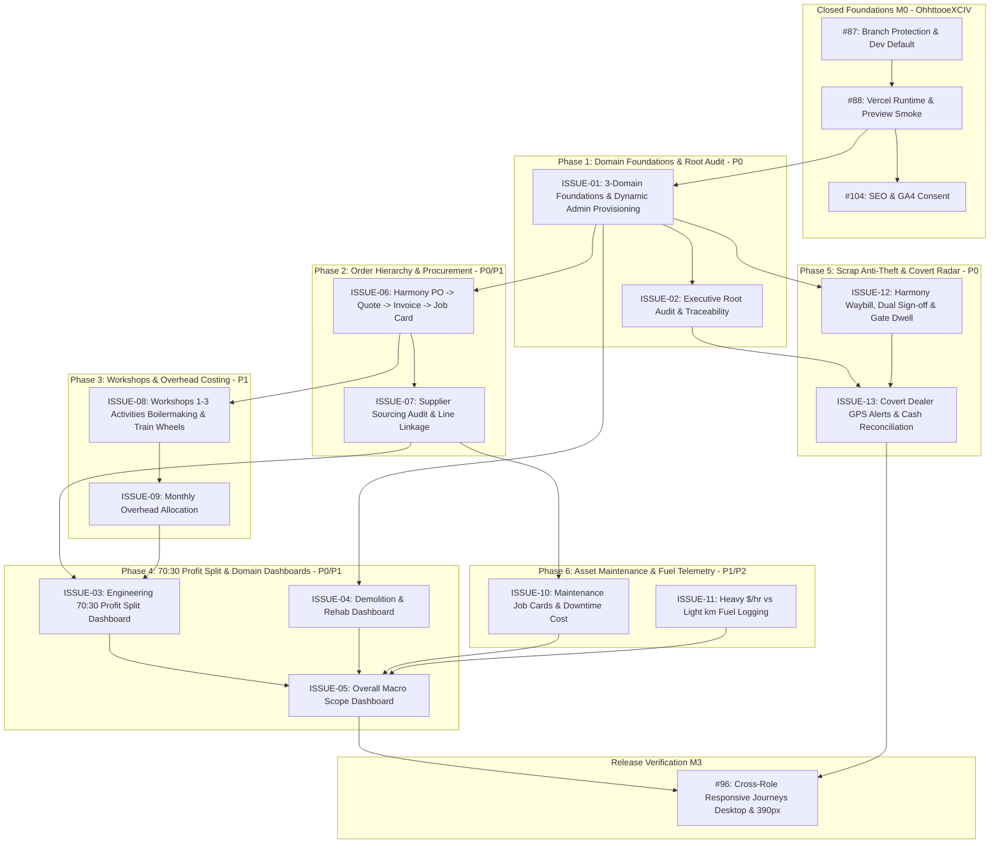

# Senatla Ops GitHub Delivery Backlog
Updated 8 November 2026

This backlog converts the repository audit, client feedback, and release cycles into an authoritative, implementation-ready delivery register. All broad issues serve as outcome epics; tasks define precise delivery boundaries with acceptance criteria, dependencies, estimates, owners, milestones, and board fields.

## Current delivery state

- **Assignee:** All repository issues and tasks are assigned to **OhhttooeXCIV** (with co-assignment to Sankofa-Digital-XCIV on reusable foundation issues 19 and 20).
- **Board Alignment:** All issues (4 through 20, 86 through 104, and newly planned issues ISSUE-01 through ISSUE-13) are tracked on the [Senatla Ops Project Board](https://github.com/orgs/Sankofa-Digital-Studio/projects/2).
- **v0.5.3 Closeout Status:** **COMPLETE**. Physical UAT confirmed forced-password replacement and Director navigation for `thosontula+tag@gmail.com`; exact `thosontula@gmail.com` developer override and alias anti-escalation regressions are verified.
- **v0.5.4 Release Status:** **COMPLETE**. Promoted through `dev` → `preview` → `main`, tagged as `v0.5.4`. Public landing SEO (#104), consented GA4 analytics (#110), formula-driven analytics workbook (#111), responsive verification (#112), and protected UAT runtime preflight (#88) have passed verification.
- **Current Development Focus:** Client Feedback Phase 1 — Domain foundations (Engineering, Demolition & Rehabilitation, Overall Macro Scope), Executive Root Audit (`rubinthoso` / `thosontula`), Harmony P/O hierarchy, Workshops 1–3, and Scrap material chain-of-custody.

---

## Ordered Micro-Task and Version Register

| Order | Version | Issue / Task | Assignee | Status | Acceptance Criteria | Completion & Verification Evidence (OhhttooeXCIV) |
|---:|---|---|:---:|:---:|---|---|
| 1 | v0.5.3 closeout | Physical Director Login | OhhttooeXCIV | **COMPLETE** | Sign in with `thosontula+tag@gmail.com`, change temporary password, navigate Director workspace | Successful forced-password journey and authenticated Director workspace verified on device |
| 2 | v0.5.3 closeout | Developer Override Verification | OhhttooeXCIV | **COMPLETE** | Verify exact `thosontula@gmail.com` receives permanent cross-workspace management access | Role-route assertions pass; no forced credential reset; access contract verified |
| 3 | v0.5.3 closeout | Alias Anti-Escalation Test | OhhttooeXCIV | **COMPLETE** | Distinguish exact developer address from `+tag` aliases | Exact address gets override; alias receives assigned Director permissions only |
| 4 | v0.5.4 | SEO & Route Boundary Audit | OhhttooeXCIV | **COMPLETE** | Audit robots rules, sitemap, and public vs authenticated route boundaries | Matrix documented in `docs/seo-indexing-matrix.md` |
| 5 | v0.5.4 | Index Only `/landing` | OhhttooeXCIV | **COMPLETE** | Dedicated indexable public landing page with canonical URL | Implemented via PR #109 (`dbca30d`), verified on production alias |
| 6 | v0.5.4 | Route Header Protection | OhhttooeXCIV | **COMPLETE** | `noindex, nofollow, noarchive` on root, login, register, and protected workspaces | Automated route metadata tests and Vercel response header rules active |
| 7 | v0.5.4 | Canonical Origin Config | OhhttooeXCIV | **COMPLETE** | Production canonical resolves strictly to approved HTTPS origin | `SENATLA_CANONICAL_ORIGIN` enforced in `scripts/write-runtime-config.mjs` |
| 8 | v0.5.4 | Structured Metadata | OhhttooeXCIV | **COMPLETE** | Factual Open Graph, Twitter Card, and SoftwareApplication JSON-LD | Validated against schema.org and social preview debuggers |
| 9 | v0.5.4 | Accessible Cookie Consent | OhhttooeXCIV | **COMPLETE** | Keyboard-operable, versioned Accept/Decline analytics prompt on `/landing` | Verified in Playwright responsive suite; suppressed on protected routes |
| 10 | v0.5.4 | Configurable GA4 Loader | OhhttooeXCIV | **COMPLETE** | Blank measurement ID completely disables script loading and consent prompt | Implemented via PR #110; verified with empty `SENATLA_GA4_MEASUREMENT_ID` |
| 11 | v0.5.4 | Three-Event Allow-List | OhhttooeXCIV | **COMPLETE** | Restrict analytics emissions to `landing_view`, `sign_in_click`, `apk_download` | Verified in unit and browser suites; zero operational/PII payloads emitted |
| 12 | v0.5.4 | Analytics Privacy Tests | OhhttooeXCIV | **COMPLETE** | Ensure no user identity, operational data, or internal amounts are logged | Test suite `src/app/core/services/analytics.service.spec.ts` passing |
| 13 | v0.5.4 | GA4 Import Workbook | OhhttooeXCIV | **COMPLETE** | Formula-preserving, GA4 import-ready `.xlsx` with no synthetic results | Generated via PR #111 (`docs/analytics-workbook-v0.5.4.md`) |
| 14 | v0.5.4 | Full Release Verification | OhhttooeXCIV | **COMPLETE** | SEO, consent, accessibility, pgTAP, unit, and responsive suites green | `npm run verify` passed cleanly across all required gates (PR #112) |
| 15 | v0.5.4 | Deployment & Evidence Record | OhhttooeXCIV | **COMPLETE** | Record preview/production URLs, release notes, changelog, and tag `v0.5.4` | Production deployed (`ac457b3`), tag `v0.5.4` pushed, health validation PASS |

---

## Master Issues Register (Prior & Newly Planned Work)

| Issue ID | Priority | Stage | Assignee | Status | Predecessors | Title & Summary | Acceptance Criteria & Verification Record (OhhttooeXCIV) |
|:---|:---:|:---:|:---:|:---:|:---|:---|---|
| **#87** | P0 | M0 | OhhttooeXCIV | **CLOSED** | None | Make `dev` integration default & protect `main` | **Criteria:** `dev` is default branch; PRs require review; `main` is protected release target. **Verification:** Verified in git configuration and branch policies. |
| **#88** | P0 | M0 | OhhttooeXCIV | **CLOSED** | #87 | Verify Vercel runtime config & hosted preview smoke | **Criteria:** Runtime config accessible via bypass; smoke test suite executes on preview. **Verification:** Preflight passed on UAT preview; curl preflight optimized; commit `d171dcfb` verified. |
| **#104** | P1 | M3 | OhhttooeXCIV | **CLOSED** | #88 | Landing-only SEO boundary & consented GA4 analytics | **Criteria:** Single indexable `/landing`, strict noindex headers elsewhere, privacy consent. **Verification:** Delivered in PRs #109 and #110, verified in v0.5.4 production deployment. |
| **#86** | P1 | M1 | OhhttooeXCIV | Ready | #87 | Idempotent site setup, trips, attendance & site-day records | **Criteria:** Single idempotent site-day mutation; offline sync queue with conflict handling. **Verification:** pgTAP test `site_day_delivery_contract.sql`. |
| **#89** | P1 | M1 | OhhttooeXCIV | Ready | #86 | Enforce issue ownership, SLA & immutable history in DB | **Criteria:** Issue state transitions recorded in immutable history; SLA calculation triggers. **Verification:** pgTAP test `operational_issue_history.sql`. |
| **#94** | P1 | M1 | OhhttooeXCIV | Ready | #87 | Private storage objects replacing inline/free-text evidence | **Criteria:** Evidence stored in authenticated private buckets; pre-signed access only. **Verification:** Storage RLS contract and file-retrieval tests. |
| **#95** | P2 | M1 | OhhttooeXCIV | Ready | #94 | Generate & verify approved documents from single command | **Criteria:** One-click compilation of PDF/Word client artifacts from immutable data. **Verification:** Document generation test scripts pass. |
| **#90** | P1 | M2 | OhhttooeXCIV | Ready | #89 | Failed pre-start inspections converted to safety blocks | **Criteria:** Failed inspection locks asset state to 'unsafe_blocked'; requires supervisor review. **Verification:** Asset safety state transition contract. |
| **#91** | P1 | M2 | OhhttooeXCIV | Ready | #87 | Stage asset CSV imports with conflict reporting | **Criteria:** Pre-import staging table; identifies duplicate VIN/plate/serial before writing. **Verification:** Conflict preview test with mock duplicates. |
| **#93** | P1 | M2 | OhhttooeXCIV | Ready | #90 | Database-enforced independent return-to-service approval | **Criteria:** Return-to-service requires distinct maker-checker signature from repairer. **Verification:** pgTAP role-negative authorization contract. |
| **#92** | P1 | M2 | OhhttooeXCIV | Ready | #86, #89 | Replace hard-coded executive claims with source-backed metrics | **Criteria:** All dashboard KPIs resolve to persisted SQL aggregation rows; zero synthetic claims. **Verification:** KPI reconciliation audit script. |
| **ISSUE-01** | **P0** | M1 | OhhttooeXCIV | **PLANNED** | #87, #88 | **3-Domain Operational Scope & Dynamic Admin Provisioning** | **Criteria:** Scopes Engineering, Demolition & Rehab, and Overall Macro. Director has full unconditional CRUD. Director has management UI to grant/revoke specific domain permissions for Office Admins. **Verification:** pgTAP domain separation tests; Office Admin permission-toggle journey. |
| **ISSUE-02** | **P0** | M1 | OhhttooeXCIV | **PLANNED** | ISSUE-01 | **Executive Root Audit & Admin Activity Traceability** | **Criteria:** All Office Admin actions logged to `admin_activity_logs`. Actions take effect immediately without pre-approval. Log viewable **strictly and exclusively** by `rubinthoso@senatlatrading.com` and `thosontula@gmail.com` / `thosontula+*@gmail.com`. **Verification:** RLS test proving ordinary Directors and Admins receive 0 rows; executive accounts view complete audit feed. |
| **ISSUE-06** | **P0** | M2 | OhhttooeXCIV | **PLANNED** | ISSUE-01, #95 | **Client P/O → Quote → Invoice → Job-Card Parent-Child Flow** | **Criteria:** Harmony PO is parent; Quote and Invoice are children. Job-Cards track execution micro-steps, inputs, and outputs. **Verification:** Cascade integrity tests; end-to-end PO lifecycle journey test. |
| **ISSUE-07** | **P1** | M2 | OhhttooeXCIV | **PLANNED** | ISSUE-06 | **Supplier & Vendor Sourcing Audit with Job-Card Line Linkage** | **Criteria:** Unique vendor order numbers; supplier invoice line items mapped to specific job cards; monthly totals and Cost-to-Company per supplier. **Verification:** Sourcing drill-down tests (`PO → Job Card → Vendor Invoice`). |
| **ISSUE-08** | **P1** | M2 | OhhttooeXCIV | **PLANNED** | ISSUE-01, ISSUE-06 | **Workshops 1–3 Activities (Boilermaking & Train Wheels CRUD)** | **Criteria:** CRUD tracking for Boilermaking and Train Wheels across Workshops 1, 2, and 3; status, cycle times, quality sign-offs. **Verification:** Workshop CRUD integration tests; batch-to-job-card linkage validation. |
| **ISSUE-09** | **P1** | M2 | OhhttooeXCIV | **PLANNED** | ISSUE-08 | **Monthly Scope Variable & Non-Variable Workshop Overheads** | **Criteria:** Monthly log per workshop of power, water, rent, municipal, gas, fuel, PPE, ad-hoc; overhead absorption calculated per active job card. **Verification:** Monthly utility entry tests; overhead absorption calculation contract. |
| **ISSUE-03** | **P0** | M3 | OhhttooeXCIV | **PLANNED** | ISSUE-01, ISSUE-06, ISSUE-07, ISSUE-09, #92 | **Engineering Operational & 70:30 Profit Split Dashboard** | **Criteria:** Tracks inputs vs outputs; calculates Net Profit = Billed Revenue - Materials - Direct Labour - Absorbed Overheads; computes 70:30 Senatla:Shareholder split; expense-lock prevents dividend declaration if open unbilled orders exist. **Verification:** Profit calculation formula tests; anti-tampering expense lock validation. |
| **ISSUE-04** | **P1** | M3 | OhhttooeXCIV | **PLANNED** | ISSUE-01, #92 | **Demolition & Rehabilitation Operational Dashboard** | **Criteria:** Phase tracking (West Gold, Tau Mine, Villages); BOQ margin tracking; salvage rubble vs rehabilitation progress. **Verification:** Phase aggregate tests; BOQ variance calculation assertions. |
| **ISSUE-05** | **P1** | M3 | OhhttooeXCIV | **PLANNED** | ISSUE-03, ISSUE-04 | **Overall Macro Scope (Combined P&L & Bottlenecks) Dashboard** | **Criteria:** Consolidated view rolling up Engineering and Demolition/Rehab; group P&L, cash flow, fleet utilization, bottleneck radar. **Verification:** Multi-domain rollup tests; cross-domain metric accuracy checks. |
| **ISSUE-10** | **P1** | M2 | OhhttooeXCIV | **PLANNED** | #90, #93, ISSUE-07 | **Asset Maintenance Job-Cards & Downtime Cost-to-Company** | **Criteria:** Downtime hours, breakdown reasons, maintenance job cards linking parts purchases to vendor invoices and technician labour. **Verification:** Asset downtime calculation tests; maintenance job card invoice linkage. |
| **ISSUE-11** | **P2** | M2 | OhhttooeXCIV | **PLANNED** | #91 | **Fleet Fuel Telemetry (Heavy $/hr vs Light Vehicle km)** | **Criteria:** Heavy machinery tracks engine hours and fuel cost/hour; light vehicles track odometer km; flags abnormal burn rate anomalies. **Verification:** Fuel rate calculation tests; consumption anomaly detection assertions. |
| **ISSUE-12** | **P0** | M2 | OhhttooeXCIV | **PLANNED** | ISSUE-01, #94 | **Harmony Scrap Waybill Intake & Dual-Custody Joint Liability** | **Criteria:** Harmony waybill number, material type (copper/steel), estimated weight; 2–3 min gate camera dwell check with photo; dual sign-off enforcing joint liability on Driver + Storage Custodian. **Verification:** Waybill intake tests; dwell timer enforcement; joint-liability sign-off contract. |
| **ISSUE-13** | **P0** | M2 | OhhttooeXCIV | **PLANNED** | ISSUE-12, ISSUE-02 | **Covert Director Proximity GPS Beacons & Cash Reconciliation** | **Criteria:** GPS coordinates pinged against scrap dealer geofences; covert alert stream to Director Dashboard only (hidden from drivers); dealer weighbridge and cash receipt reconciliation. **Verification:** Geofence alert triggering test; RLS privacy test confirming driver client receives no alert payload; cash reconciliation variance test. |
| **#96** | P0 | M3 | OhhttooeXCIV | Ready | #86, ISSUE-03, ISSUE-05, ISSUE-12 | Desktop & 390 px release journeys for every role | **Criteria:** End-to-end browser journeys for Site Manager, Office Admin, and Director across viewports. **Verification:** Automated Playwright responsive test runs passing on all viewports. |
| **#97** | P1 | M4 | OhhttooeXCIV | Backlog | #88 | Publish a reusable Sankofa application quality workflow | **Criteria:** Modular CI workflow reusable across Sankofa ERP repositories. **Verification:** External template deployment and consumption test. |

---

## Critical Dependency Graph

---

## Definition of Done for All Issues (OhhttooeXCIV)

1. **Authorization & Boundary Contracts:** Every data mutation must enforce PostgreSQL RLS policies with automated role-negative tests proving unauthorized roles receive 0 rows.
2. **Immutable Audit Trail:** All Office Admin operations produce structured records in `admin_activity_logs`, queryable only by the executive email addresses.
3. **Deterministic Verification:** Every pull request must pass `npm run verify` (type-checking, linting, production build, unit tests) and relevant pgTAP contracts.
4. **Responsive Verification:** UI changes must be verified at both desktop (1440px) and mobile (390px) viewports before promotion.
5. **Release Promotion Sequence:** All work targets `dev`; promotions follow `dev` → `preview` → `main` with verified commit SHAs and recorded deployment health checks.
