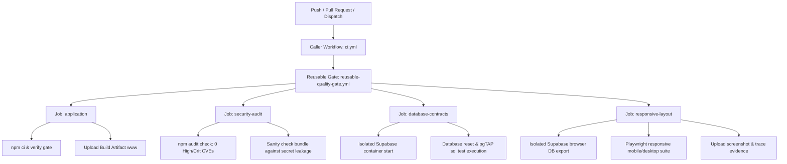

# Sankofa ERP Reusable CI/CD, Security & Quality Pipeline Guide

## Overview

This guide establishes the standardized, reusable delivery architecture for **Senatla Ops** and future **Sankofa ERP** applications. It ensures that every project inherits the same enterprise-grade quality gates, database contract tests, security audits, and evidence retention policies from its very first commit.

---

## 1. Pipeline Architecture

The delivery pipeline is structured into a modular `workflow_call` template located at [`.github/workflows/reusable-quality-gate.yml`](../.github/workflows/reusable-quality-gate.yml).



---

## 2. Reusable Workflow Specification

### Caller Configuration (`.github/workflows/ci.yml`)

Consumer repositories invoke the reusable gate with standard parameters:

```yaml
name: Senatla Ops quality gates

on:
  pull_request:
  workflow_dispatch:
  push:
    branches: [dev, preview, main]

permissions:
  contents: read

concurrency:
  group: senatla-ops-${{ github.ref }}
  cancel-in-progress: true

jobs:
  quality-gate:
    uses: ./.github/workflows/reusable-quality-gate.yml
    with:
      node-version: "24.15.0"
      supabase-version: "2.114.0"
      enable-application: true
      enable-supabase: true
      enable-responsive: true
      enable-security-audit: true
      verify-command: "npm run verify"
      api-mode: "local"
      artifact-name: "senatla-ops-web"
      artifact-retention-days: 14
```

### Input Parameters Reference

| Input Parameter | Type | Default | Description |
| :--- | :--- | :--- | :--- |
| `node-version` | `string` | `"24.15.0"` | Pinned Node.js runtime version |
| `supabase-version` | `string` | `"2.114.0"` | Pinned Supabase CLI release |
| `enable-application` | `boolean` | `true` | Runs lint, typecheck, build, and unit tests |
| `enable-supabase` | `boolean` | `true` | Starts Docker container, resets schema, and executes pgTAP tests |
| `enable-responsive` | `boolean` | `true` | Runs Playwright mobile/desktop responsive browser journeys |
| `enable-security-audit` | `boolean` | `true` | Enforces zero high/critical package CVEs and secret scan |
| `verify-command` | `string` | `"npm run verify"` | Local quality command executed in `application` job |
| `api-mode` | `string` | `"local"` | Operational API mode passed to `SENATLA_API_MODE` |
| `artifact-name` | `string` | `"senatla-ops-web"` | Name of compiled web distribution zip artifact |
| `artifact-retention-days` | `number` | `14` | Expiration retention window for generated artifacts |

---

## 3. Secret & Environment Variable Inventory Template

Future Sankofa ERP applications adopting this pipeline require the following standard secrets configured in repository settings:

| Secret / Env Var | Scope | Purpose | Required For |
| :--- | :--- | :--- | :--- |
| `SENATLA_SUPABASE_URL` | Application Runtime | Target Supabase Project HTTPS endpoint | Preview / Production |
| `SENATLA_SUPABASE_ANON_KEY` | Application Runtime | Public anonymous key guarded by PostgreSQL RLS | Client App Shell |
| `SUPABASE_SERVICE_ROLE_KEY` | CI / Serverless Only | Migration runner and administrative scripts | CI Database Reset & APIs |
| `VERCEL_AUTOMATION_BYPASS_SECRET` | CI Workflow | Bypasses Vercel deployment protection in preview smoke | Hosted Smoke Pipeline |
| `SENATLA_QA_EMAIL` | CI Secret | Test credentials for automated Playwright sign-in | Hosted Browser Smoke |
| `SENATLA_QA_PASSWORD` | CI Secret | Password for test account | Hosted Browser Smoke |

> [!CAUTION]
> `SUPABASE_SERVICE_ROLE_KEY` must **never** be injected into client bundles or `runtime-config.json`. The pipeline's `security-audit` step validates that client distributions do not leak service role identifiers.

---

## 4. Local vs. CI Parity Commands

Developers must be able to reproduce every quality check locally prior to opening pull requests:

```bash
# 1. Full deterministic gate (lint + typecheck + build + unit tests + scripts)
npm run verify

# 2. Individual targeted validations
npm run lint
npm run typecheck
npm run test:ci

# 3. Security vulnerability audit
npm audit --audit-level=high

# 4. Local Supabase container and database contracts
npm run supabase:start
npm run supabase:reset
npm run supabase:test

# 5. Playwright responsive layout tests
npm run test:responsive
```

---

## 5. Consumer Adoption Checklist for New Repositories

When bootstrapping a new Sankofa ERP solution:

- [ ] **Step 1: Copy Workflow Templates**
  - Place `reusable-quality-gate.yml` into `.github/workflows/reusable-quality-gate.yml`.
  - Place `ci.yml` caller workflow into `.github/workflows/ci.yml`.
  - Add scheduled vulnerability monitoring via `security-audit.yml`.
- [ ] **Step 2: Dependabot Configuration**
  - Copy `.github/dependabot.yml` to schedule weekly Monday dependency updates for npm and GitHub Actions.
- [ ] **Step 3: Branch Protection Rules**
  - Configure branch protection on `main`, `preview`, and `dev`.
  - Require the `quality-gate / application`, `quality-gate / supabase`, and `quality-gate / security-audit` status checks to pass before merging.
- [ ] **Step 4: Local Parity Verification**
  - Confirm `scripts/verify.mjs` executes cleanly locally.
- [ ] **Step 5: Secret Provisioning**
  - Populate repository secrets matching the inventory template above.
