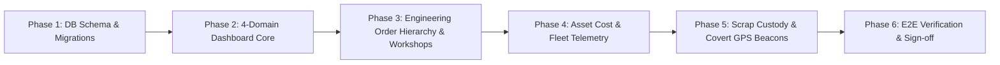

# Senatla Trading Client Feedback: Multi-Dashboard, Engineering Workflow & Scrap Security Plan

## Goal Description

This implementation plan translates the comprehensive Senatla Trading client feedback into a production-grade enterprise architecture across Senatla Ops. The solution establishes:
1. **Four Specialized Dashboards** (Engineering, Demolition & Rehabilitation, Underground Works, and Overall Macro Scope) for Director and Office Admin roles with 2-user provisioning per domain.
2. **Engineering Operational & Financial Engine** with transparent 70:30 profit split accounting (Senatla Trading : Shareholders), anti-manipulation expense reconciliations, and an end-to-end hierarchy: `Client Purchase Order (P/O) → Quote → Invoice → Job Card → Vendor/Supplier Sourcing Audit`.
3. **Workshop Control & Overhead Tracking** across Workshops 1, 2, and 3, covering direct boilermaking, train wheel manufacturing, and monthly-scoped variable and non-variable overhead allocations (power, water, gas, rent, PPE, fuel).
4. **Asset Cost to Company Tracking** covering breakdown downtime, maintenance job cards (parts + labour), hourly fuel burn for heavy machinery, and kilometer fuel logs for light vehicles.
5. **Scrap Metal Chain of Custody & Security Control** for copper and salvaged steel, enforcing Harmony waybill capture, dual-custody liability sign-offs, a simplified 2–3 minute gate entry dwell verification with snapshot support, and covert Director dashboard proximity GPS beacon alerts when vehicles enter proximity of local scrap dealers.

---

## Architectural Decisions Locked In

> [!NOTE]
> **Key Decisions Confirmed by Stakeholder:**
> 1. **Scrap Dealer Proximity Alerts:** Driven by **Proximity GPS Pings** from driver device coordinates against a geofenced directory of known local scrap dealerships. The event stream is covert (enforced at the Postgres RLS level), pinging exclusively to the Director Dashboard and never displaying on driver or gate-guard interfaces.
> 2. **Gate Entry Camera Dwell Check:** **Simplified Solution for Now**. The system implements a structured gate dwell record enforcing a 2–3 minute timer between vehicle arrival and gate clearance, with optional snapshot evidence upload. Complex camera hardware/LPR integrations are deferred until full camera installation specs are delivered.
> 3. **Workshop Overhead Absorption:** Modeled on a **Monthly Scope**. Overheads (electricity, water, municipal, rent, gas, diesel, PPE) are logged monthly per workshop (Workshops 1, 2, and 3) and absorbed across monthly active job cards.

---

## Phased Implementation Roadmap

### Phase 1: Database Schema & Migrations (Supabase)
- **Domain Foundations:** Enum types (`engineering`, `demolition_rehab`, `underground_works`, `overall_macro`), user-provisioning table (max 2 active users per dashboard).
- **Engineering Hierarchy:** `client_purchase_orders` (Harmony P/O parent), `client_quotes`, `client_invoices`, `job_cards`, `vendor_purchase_orders`, `supplier_invoices`, and `engineering_profit_reconciliations` (70:30 profit engine with anti-tamper locking).
- **Workshops & Overheads:** `workshops` (Workshops 1–3), `workshop_activities` (Boilermaking, Train Wheels), `workshop_monthly_overheads` (monthly utility & variable expense logs).
- **Asset Telemetry:** `asset_maintenance_records`, `maintenance_job_cards`, `asset_fuel_telemetry` (hourly rate for heavy machinery, km logs for light vehicles).
- **Scrap Chain of Custody:** `scrap_consignments` (Harmony waybill, material type, weight), `scrap_custody_transfers` (dual-custody liability agreement between Driver and Storage Officer), `gate_dwell_logs` (2–3 min entry dwell verification), `scrap_dealers` (lat/lng registry), and `scrap_dealer_proximity_alerts` (RLS restricted exclusively to `director`).

### Phase 2: Multi-Domain Dashboards (Director & Office Admin)
- Create the 4-Domain Navigation Switcher in `src/app/pages/director/` and `src/app/pages/office-admin/`.
- Build domain-specific metrics cards:
  - **Engineering:** P/O fulfillment, 70:30 profit calculations, supplier cost-to-company drill-downs.
  - **Demolition & Rehab:** Phase schedules, BOQ margins, salvage/rubble reconciliation.
  - **Underground Works:** Shaft operations, shift attendance, safety blocks, consumable burn.
  - **Overall Macro Scope:** Executive rollup, consolidated P&L, cross-domain cash flow, active bottleneck radar.

### Phase 3: Engineering Order Intake & Workshop Operations
- Office Admin workflow: Intake Harmony P/O → Draft Quote → Issue Invoice → Generate Job Card.
- Supplier sourcing audit: Record unique supplier order numbers, link supplier invoice line items directly to job cards, display supplier monthly totals and cost-to-company.
- Workshop activities: CRUD interface for Boilermaking and Train Wheel manufacturing batches.
- Monthly overhead entry: Input monthly utilities and non-variable expenses per workshop, calculating net absorbed overhead cost per job card.

### Phase 4: Asset Cost & Fleet Tracking
- Asset maintenance: Log breakdown reasons, downtime hours, and attach maintenance job cards (spares purchases + labour hours).
- Fleet fuel telemetry:
  - Heavy machinery: Engine operating hours, fuel capacity, hourly burn rate ($/hr).
  - Light vehicles: Odometer km logs, trip logging, fuel efficiency tracking.

### Phase 5: Scrap Material Security & Covert Beacons
- Waybill intake: Record Harmony waybill, material classification (copper, steel, etc.), estimated weight, vehicle, driver.
- Gate dwell check: Timer enforcing a 2–3 minute dwell window before gate clearance, with photo evidence upload.
- Secured storage transfer: Dual authenticated sign-off with clear joint liability confirmation (Driver + Storage Officer).
- Proximity GPS alert engine: Background GPS coordinate checking against known scrap dealer geofences; real-time alert displayed exclusively on the Director Dashboard (covert, hidden from driver interface).
- Scrap dealer reconciliation: Record weighbridge certificate, cash sale receipt, and compute scale variance against the Harmony waybill.

### Phase 6: Automated Verification & Documentation
- pgTAP database contract tests for RLS policies, 70:30 calculations, and joint liability constraints.
- Angular Jasmine/Karma unit tests for domain calculations and service gateways.
- End-to-end verification via `npm run verify`.

---

## Verification Plan

### Automated Tests
* `supabase/tests/multi_dashboard_domain_contract.sql`: Verifies domain separation and user provisioning limits.
* `supabase/tests/engineering_order_contract.sql`: Tests P/O → Quote → Invoice → Job Card foreign key integrity and 70:30 profit split math.
* `supabase/tests/scrap_security_rls_contract.sql`: Tests that ordinary accounts and drivers cannot view or subscribe to `scrap_dealer_proximity_alerts`, while Directors receive real-time notifications.
* `npm test`: Runs domain service unit tests.
* `npm run verify`: Full production compile and lint gate.

### Manual Verification Journey
1. **Engineering Flow:** Create Harmony PO → Generate Quote → Generate Job Card → Assign Supplier Invoice → Verify 70:30 calculation on Engineering Dashboard.
2. **Monthly Overhead:** Log Workshop 1 monthly electricity/rent → Verify job-card cost absorption.
3. **Scrap Custody:** Log Harmony Waybill (Copper) → Record 2.5 min gate dwell with photo → Complete dual sign-off → Trigger scrap dealer proximity ping → Verify alert displays only on Director Dashboard → Record final dealer cash receipt.
